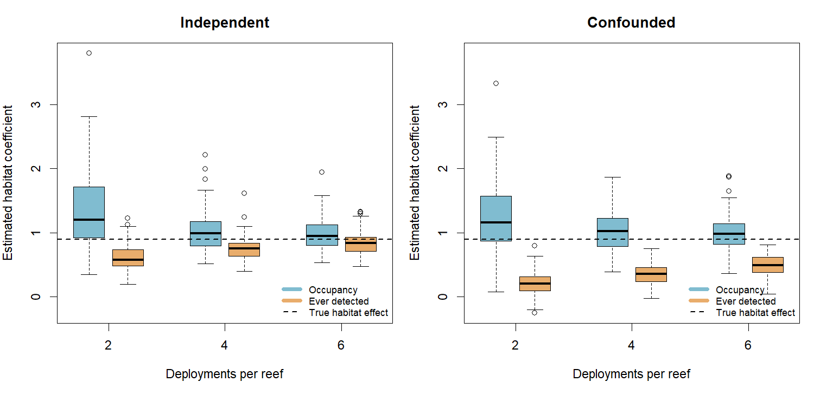

# Can repeated BRUV deployments recover a shark habitat association?

This project applies the single-species occupancy model from Doser et al. (2022) to simulated whitetip reef shark surveys. It compares the Bayesian model in spOccupancy with a logistic regression of whether a shark was ever recorded at a reef. All survey records and parameter values are synthetic. The project tests recovery of a known effect under specified survey conditions.

## Results at a glance



When better habitat had poorer visibility, six deployments per reef recovered a mean habitat effect of **1.00** with the occupancy model and **0.49** with the ever-detected model. The simulated truth was **0.90**.

| Deployments per reef | Occupancy fits flagged for convergence | Total occupancy fits |
| ---: | ---: | ---: |
| 2 | 130 | 200 |
| 4 | 16 | 200 |
| 6 | 2 | 200 |

[Bayesian results](results/pgocc/summary.csv) · [Per-fit estimates](results/pgocc/replicates.csv) · [Maximum-likelihood results](results/mle/summary.csv)

## Run

Open the RStudio project or start R in this folder. Install the package once:

```r
install.packages("spOccupancy", repos = "https://cloud.r-project.org")
source("check-simOcc.R")
```

Run the full study from a terminal in the project folder. The last two arguments are the number of replicates and parallel workers.

```sh
Rscript --vanilla run.R pgocc 100 4
```

For a quick run use one replicate and one worker. A run overwrites prior results for that engine. Run the additional maximum-likelihood check with `Rscript --vanilla run.R mle 100`. It uses the same occupancy and detection structure with Wald intervals and requires only base R. Both engines use the same simulated data when run with the same replicate count. The scripts use a fixed RNG seed and per-fit seeds, so changing worker count preserves the simulation design and random draws. See the session-info files for the software versions.

## Survey design

Each replicate generates 150 reefs with a standardized habitat covariate. The occupancy probability is logistic with intercept -0.3 and habitat slope +0.9. Each occupied reef can yield a detection on each visit with a logistic intercept of -0.9 and a visibility slope of +0.8. Unoccupied reefs always yield zeros. The two visibility scenarios set mean visibility to either zero or -0.8 times the habitat score. Visit-level visibility varies around that mean with standard deviation 1. In the second scenario better habitat therefore tends to have poorer visibility. The scenarios share the same latent reefs and random draws, and the 2- and 4-visit surveys use the first visits of the 6-visit survey.

The model assumes one closed survey window per reef, independent reefs, no false positives, and conditionally independent repeat detections given reef use and measured visibility. Real BRUV deployments can violate these assumptions. The number of deployments studied here is specific to the simulated conditions.

## Models and outputs

- `check-simOcc.R` runs a small example using the authors' simulator and fitting function. The main experiment simulates explicitly to control the habitat-visibility relationship and share random draws across designs.
- `R/models.R` simulates the surveys and fits both models. The occupancy model uses normal priors with mean 0 and variance 6.25, and four chains with 1,200 iterations each, discarding 400 from each chain. Intervals are equal-tail 95% credible intervals. The ever-detected regression uses 95% Wald confidence intervals.
- `results/pgocc/replicates.csv` gives per-fit estimates, interval bounds, model warnings or errors, and the package's Gelman-Rubin diagnostic for the habitat slope. The package reports the upper confidence limit of that diagnostic. The summary flags usable estimates over 1.05 for review and retains them in performance metrics.
- `summary.csv` reports mean signed bias, RMSE, and the share of usable intervals containing +0.9, with Monte Carlo standard error. Failed fits are counted separately through the difference between attempted and usable.
- `habitat-recovery.png` shows distributions of estimated coefficients. The dashed line marks the true value of +0.9.

The ever-detected model estimates a relationship with being recorded at least once. Its coefficient and interval are compared with the occupancy truth to quantify what happens when it is used as a proxy for habitat use.

## Results from the included run

All 600 Bayesian occupancy fits returned estimates. When better habitat had poorer visibility, the mean estimate with six deployments was 1.00 for occupancy and 0.49 for the ever-detected regression, versus a simulated truth of 0.90. Their RMSE values were 0.30 and 0.44, respectively. With independent visibility and six deployments, the ever-detected regression had lower RMSE (0.19 versus 0.25), although it estimates a different outcome.

The package's Gelman-Rubin diagnostic exceeded 1.05 for 130 of 200 occupancy fits at two deployments, 16 of 200 at four, and 2 of 200 at six. The two-deployment summaries include those fits and should be interpreted cautiously. The independent maximum-likelihood check also showed instability with two visits, including four unusable fits in the habitat-dependent visibility scenario. The R 4.3.1 environment emitted an lme4/Matrix compatibility warning on package load. All Bayesian fixed-effect fits completed.

## Reference

Doser, J. W., Finley, A. O., Kery, M., & Zipkin, E. F. (2022). spOccupancy: An R package for single-species, multi-species, and integrated spatial occupancy models. *Methods in Ecology and Evolution*, 13, 1670-1678. [Paper](https://doi.org/10.1111/2041-210X.13897) | [Authors' original reproduction materials](https://github.com/zipkinlab/Doser_etal_2022_MEE_A).


